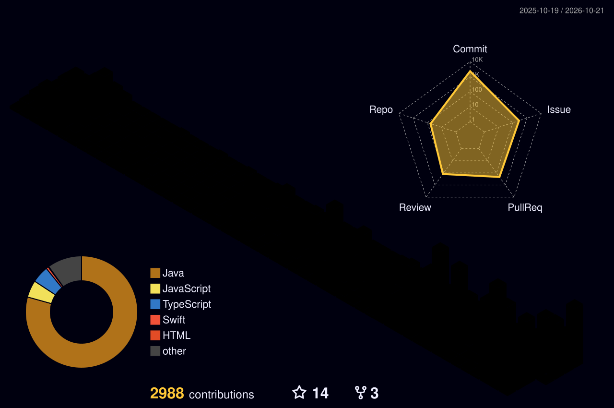

## 🎓 Education

| 기간 | 교육 | 내용 |
| --- | --- | --- |
| 2026.02–2026.11 예정 | **우아한테크코스 8기 백엔드** | Java·Spring, 객체지향 설계, 테스트, 코드 리뷰 · 진행 중 |
| 2020.03–2026.02 | **고려대학교 세종캠퍼스** | 인공지능사이버보안학과 공학사 · 사이버보안 마이크로디그리 |
| 2024.08–2024.10 | **수도권 ICT 이노베이션스퀘어** | 블록체인 심화 160시간 수료 · 팀 프로젝트 최우수상 |

## 📄 Patent

**블록체인을 기반으로한 구매 영수증 관리 시스템 및 그 방법** · 공동 발명자

NFT 기반 구매 영수증 관리 아이디어를 공동 발명으로 출원하고, 이후 [내산](https://github.com/poketopa/naesan)에서 Java·Spring 기반 구매 이력 검증 서비스로 재설계했습니다.

| 출원번호 · 출원일 | 공개번호 · 공개일 |
| --- | --- |
| 10-2024-0201784 · 2024.12.31 | 10-2026-0062002 · 2026.05.06 |

[공개 공보 보기](https://patents.google.com/patent/KR20260062002A/en)

## 🌱 Open Source

| Project | Contribution | Pull request |
| --- | --- | --- |
| <a href="https://github.com/toss/es-git"> <strong>es-git</strong></a> | 외부 서명용 commit buffer·signed commit API 구현 |  |
| <a href="https://github.com/toss/es-git"> <strong>es-git</strong></a> | Node.js 지원 버전과 영문·한글 설치 문서 정비 |  |
| <a href="https://github.com/openrewrite/rewrite-github-actions"> <strong>OpenRewrite</strong></a> | setup-python의 Python 버전을 업그레이드하는 recipe 구현 |  |
| <a href="https://github.com/chattymin/PokeTokenBar"> <strong>PokeTokenBar</strong></a> | 대용량 Codex 로그의 Swift 스트리밍 처리와 메모리 회귀 테스트 구현 |  |
| <a href="https://github.com/line/armeria"> <strong>Armeria</strong></a> | 요청 로그의 민감 쿼리 파라미터 마스킹 API |  |
| <a href="https://github.com/toss/es-git"> <strong>es-git</strong></a> | 원격 자격증명 입력 검증과 panic 방지 |  |

PR 상태는 2026.10.15 기준입니다.

## 📜 Certifications

| 자격 | 취득·합격 시기 | 기관 |
| --- | --- | --- |
| **정보처리기사** | 2025 | 한국산업인력공단 |
| **SQL 개발자(SQLD)** | 2026.03.27 | 한국데이터산업진흥원 |
| **리눅스마스터 2급** | 2023.12.29 | 한국정보통신진흥협회 |
| **네트워크관리사 2급** | 2021.12.21 | 한국정보통신자격협회 |
| **OPIc English IH** | 2026.07.11 | ACTFL |

## 🔬 Research and Activities

| 기간 | 활동 |
| --- | --- |
| 2021 | **AES-128 CPA 학부 연구** · 전력 트레이스 기반 키 복원 실험 · [코드](https://github.com/poketopa/side-channel-attack-cpa-on-aes-128) |
| 2025 | **멋쟁이사자처럼 운영진** · 백엔드 교육·프로젝트 활동 |
| 2021.03–2021.12 | **제5대 인공지능사이버보안학과 학생회장** |
| 2020.03–2021.12 | **Kuality 해킹 동아리 · KoRec 암호 동아리** |
| 2022.04–2024.01 | **공군 정보보호병** · 병장 만기전역 |
| 2023.12.14 | **공군참모총장 우수상** · 공군 우수 독후감 선발대회 일반도서 부문 |

 

---

### Contributions

 

---

 

### GitHub & BOJ Stats
<table width="100%">
  <tr>
    <td align="center" width="50%" valign="top">
      <strong>Solved.ac</strong>  
      
    </td>
    <td align="center" width="50%" valign="top">
      <strong>GitHub Stats</strong>  
      
    </td>
  </tr>
</table>

 

---

 

### Stacks

  

